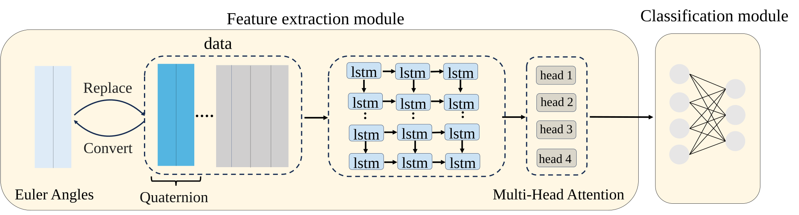
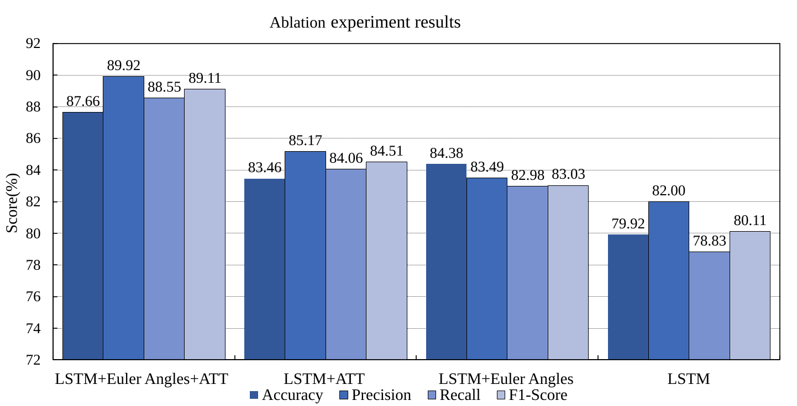

# 机器人地面分类

基于四元数转换和时序网络的机器人地面分类实验代码，包含 LSTM、GRU、RNN、SVM 和 XGBoost 五种模型。时序模型使用三层循环网络、四头自注意力和全连接分类头。

## 架构


## 目录说明

```text
ground_classification/         核心实现
  config.py                    项目路径、训练参数、实验配置保存
  features.py                  四元数归一化、欧拉角、派生特征
  data.py                      CSV 校验、时序组装、标签对齐、标准化
  models.py                    LSTM / GRU / RNN 网络与 Dataset
  training.py                  共用时序训练、验证、早停与权重保存
  baselines.py                 SVM / XGBoost 训练
  prediction.py                读取实验配置并预测
  metrics.py                   accuracy 与 macro precision / recall / F1
  plotting.py                  训练曲线
  cli.py / __main__.py          统一命令入口
dataset/
  X_train.csv                  训练传感器数据
  y_train.csv                  序列标签
X_test.csv                     无标签测试数据
tests/                         数据、特征、模型和完整流程测试
examples/fashion_mnist.py       独立教学示例，与地面分类无关
outputs/                       新实验产物（自动创建，已加入 Git 忽略）
LSTM.py / GRU.py / RNN.py       原名称的兼容入口
SVM.py / XGBoost.py             原名称的兼容入口
euler_angle.py                 原特征工具导入路径
visual_training_proccess.py     原绘图工具导入路径（保留原拼写）
quickstart.py                  统一命令的另一个启动入口
```

根目录已有的 `best_model.pth`、`scaler.pkl`、`label_encoder.pkl` 是历史产物；权重的 LSTM 输入维度和 scaler 均为 **19 维**，与当前时序代码的 9 维输入不同，且缺少对应特征顺序记录，不能直接用于当前流程。新训练不会覆盖它们。论文 PDF、改进记录 Excel 和 SVG 图稿保留原位置。

## 训练

```bash
python -m ground_classification train --model lstm
python -m ground_classification train --model gru
python -m ground_classification train --model rnn
python -m ground_classification train --model svm
python -m ground_classification train --model xgboost

# 指定训练参数和设备
python -m ground_classification train --model lstm --epochs 20 --batch-size 64 --device cpu

# 查看所有参数
python -m ground_classification train --help
```

也可使用 `python LSTM.py --epochs 20` 等旧脚本名称，或 `python quickstart.py train --model lstm`。直接运行 GRU/RNN 入口只训练；预测需使用下面的独立命令。

默认训练/验证比例为 80%/20%，随机种子为 42。时序模型默认隐藏维度 128、批次 128、最多 200 轮、AdamW 学习率 `3e-4`、权重衰减 `1e-4`，验证准确率连续 60 轮未提高时早停。LSTM 按验证损失降低学习率，GRU/RNN 使用余弦重启。

`--device auto` 保持原代码的 CUDA 优先、否则 CPU 的行为；Apple 芯片可显式指定 `--device mps`。`--grad-clip` 默认 `1e6`，保留原代码近似不裁剪的行为；要使用更强的梯度裁剪，可显式设置 `--grad-clip 1.0`。`--epochs` 等时序参数不影响 SVM，XGBoost 的训练轮数由 `--boost-rounds` 控制。

每次实验创建 `outputs/<模型>/<时间戳>/`，包含：

| 文件 | 含义 |
| --- | --- |
| `config.json` | 参数、特征顺序、序列长度 |
| `label_encoder.pkl` | 类别编码器 |
| `scaler.pkl` | 仅用训练集拟合的标准化器，XGBoost 不使用 |
| `best_model.pth` | 时序模型最佳验证准确率对应的权重 |
| `best_model.joblib` | SVM 模型 |
| `best_model.json` | XGBoost 模型；预测使用最佳迭代轮次 |
| `metrics.json` | 最佳时序轮次或传统模型的验证指标 |
| `history.csv` / `training.png` | 时序模型逐轮日志和训练图 |
| `xgboost_params.json` | XGBoost 的具体训练参数 |

曲线默认保存为文件，不弹窗。时序训练日志中的梯度范数是裁剪前的范数。

## 预测

将示例中的目录替换为训练实际打印的目录：

```bash
python -m ground_classification predict --run-dir outputs/lstm/实际时间戳

# 指定数据和输出位置；SVM / XGBoost 使用相同命令
python -m ground_classification predict \
  --run-dir outputs/gru/实际时间戳 \
  --input-csv X_test.csv \
  --output-csv outputs/gru_predictions.csv
```

默认读取根目录 `X_test.csv`，结果写入实验目录的 `submission.csv`，列为 `series_id,surface`。不需要额外的 `sample_submission.csv`。自动从 `config.json` 读取模型和特征顺序；缺少配置时会明确报错。要复用根目录历史权重，需要先找回原训练配置，确认 19 个输入特征及其顺序、隐藏维度和序列长度，再将相应产物与配置放入独立目录；不能仅按维度猜测特征顺序。

## 结果




